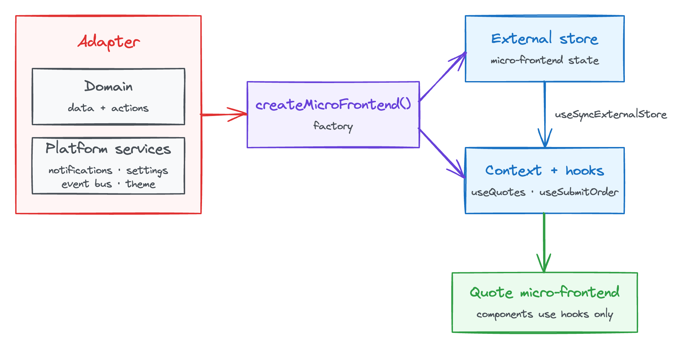

**TODO: summary for skimmers.** Recap part 1 in a sentence, then the takeaway: a
generic base micro-frontend and a factory do all the wiring, so concrete
micro-frontends only declare their state and actions, and never manage the
store's lifecycle.

## From port to React

**TODO:** Bridge from part 1. The port is a TypeScript interface; the
micro-frontend's components need a way to reach it. Set out the three pieces
this post builds: the micro-frontend context, the hooks, and the base
micro-frontend created by a factory.

## The micro-frontend context

**TODO:** Providing the adapter's implementation of the port to the React tree.
Code sample: the context and its provider. Explain why the context holds the
port implementation and the store, rather than state values, to avoid
re-rendering the whole micro-frontend.

## Hooks are the only way out

**TODO:** Components only reach the outside world through hooks, such as
`useNotifications`, `useSettings`, `usePublish` and `useSubscribe`, and the
theme. Code sample: one or two platform hooks. Point out that components never
import an adapter, which is what keeps the micro-frontend host-agnostic.

## A generic base micro-frontend

**TODO:** The base micro-frontend port is generic. Micro-frontend-specific state
and actions sit outside the base and are supplied as type parameters. Code
sample: the generic `MicroFrontendPort<TState, TActions>` interface, then the
quote micro-frontend extending it:

```ts
interface QuoteMicroFrontendPort extends MicroFrontendPort<
  QuoteState,
  QuoteActions
> {}
```

Explain what lives in the base (platform services, store access, shared hooks)
and what each micro-frontend adds.

<copy-to-clipboard data-url="/img/blog/building-a-base-micro-frontend/micro-frontend-factory.png" class="ctc-image">
  <figure>
    
    <figcaption>
      The factory builds the store and hooks from the parts an adapter supplies
    </figcaption>
  </figure>
</copy-to-clipboard>

## Creating micro-frontends with a factory

**TODO:** The factory takes the parts an adapter supplies, the domain
implementations and platform services, and creates the micro-frontend: the
external store, the context value and the hooks. Code sample: the factory
signature and a cut-down implementation. Emphasise that concrete micro-frontends
never create or dispose of the store.

## Why an external store

**TODO:** The base micro-frontend owns a store read with `useSyncExternalStore`.
Reasons to cover:

- Non-React sources, such as event bus messages and live prices, update state
  directly.
- Components subscribe to just the slice they need, so a price tick doesn't
  re-render the whole micro-frontend.
- Micro-frontend logic can be tested without React.

Link to
[Isolating React component updates with useSyncExternalStore](/blog/isolating-react-component-updates-with-usesyncexternalstore/)
for the rendering detail rather than repeating it.

## The quote micro-frontend

**TODO:** Put it together. The quote micro-frontend declares its state and
actions, adds its own hooks (such as `useQuotes` and `useSubmitOrder`) on top of
the base, and its components use only hooks. Code sample: the quote
micro-frontend's definition and one component.

## What's next

**TODO:** Point to part 3, running this same micro-frontend in four hosts and
testing it in two tiers. Link to the companion repository.
