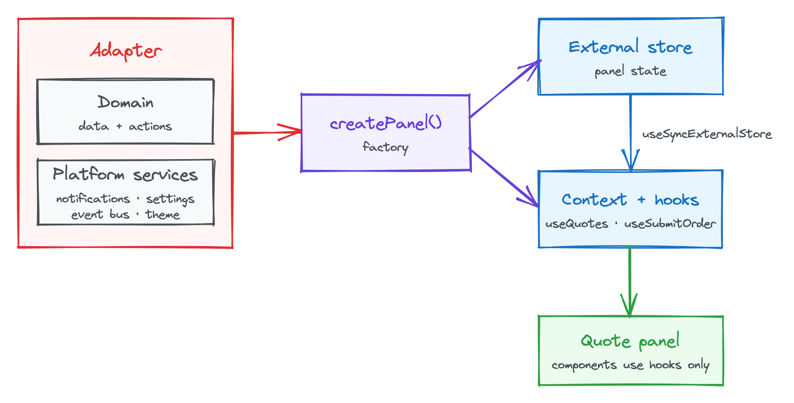

**TODO: summary for skimmers.** Recap part 1 in a sentence, then the takeaway:
a generic base panel and a factory do all the wiring, so concrete panels only
declare their state and actions, and never manage the store's lifecycle.

## From port to React

**TODO:** Bridge from part 1. The port is a TypeScript interface; the panel's
components need a way to reach it. Set out the three pieces this post builds:
the panel context, the hooks, and the base panel created by a factory.

## The panel context

**TODO:** Providing the adapter's implementation of the port to the React
tree. Code sample: the context and its provider. Explain why the context holds
the port implementation and the store, rather than state values, to avoid
re-rendering the whole panel.

## Hooks are the only way out

**TODO:** Components only reach the outside world through hooks, such as
`useNotifications`, `useSettings`, `usePublish` and `useSubscribe`, and the
theme. Code sample: one or two platform hooks. Point out that components never
import an adapter, which is what keeps the panel host-agnostic.

## A generic base panel

**TODO:** The base panel port is generic. Panel-specific state and actions sit
outside the base and are supplied as type parameters. Code sample: the generic
`PanelPort<TState, TActions>` interface, then the quote panel extending it:

```ts
interface QuotePanelPort extends PanelPort<QuoteState, QuoteActions> {}
```

Explain what lives in the base (platform services, store access, shared hooks)
and what each panel adds.

<copy-to-clipboard data-url="/img/blog/building-a-micro-frontend-base-panel/panel-factory.png" class="ctc-image">
  <figure>
    
    <figcaption>
      The factory builds the store and hooks from the parts an adapter supplies
    </figcaption>
  </figure>
</copy-to-clipboard>

## Creating panels with a factory

**TODO:** The factory takes the parts an adapter supplies, the domain
implementations and platform services, and creates the panel: the external
store, the context value and the hooks. Code sample: the factory signature and
a cut-down implementation. Emphasise that concrete panels never create or
dispose of the store.

## Why an external store

**TODO:** The base panel owns a store read with `useSyncExternalStore`.
Reasons to cover:

- Non-React sources, such as event bus messages and live prices, update state
  directly.
- Components subscribe to just the slice they need, so a price tick doesn't
  re-render the whole panel.
- Panel logic can be tested without React.

Link to
[Isolating React component updates with useSyncExternalStore](/blog/isolating-react-component-updates-with-usesyncexternalstore/)
for the rendering detail rather than repeating it.

## The quote panel

**TODO:** Put it together. The quote panel declares its state and actions,
adds its own hooks (such as `useQuotes` and `useSubmitOrder`) on top of the
base, and its components use only hooks. Code sample: the quote panel's
definition and one component.

## What's next

**TODO:** Point to part 3, running this same panel in four hosts and testing
it in two tiers. Link to the companion repository.
