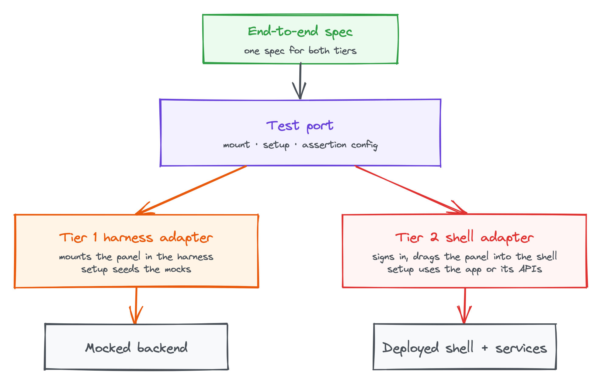

**TODO: summary for skimmers.** The payoff of parts 1 and 2: one panel, four
adapters, two test tiers. Then the honest part: the pattern makes swapping
adapters free, but it doesn't keep the data behind them consistent.

## Storybook without a backend

**TODO:** The Storybook adapter fulfils the port with in-memory fakes: no
GraphQL, no shell, no network. Show how easily any state can be rendered, such
as a rejected order, stale prices or an empty instrument list. Code sample:
the Storybook adapter and a story.

## The production shell

**TODO:** The shell loads the panel with Module Federation, and its adapter
fulfils the port with the Apollo GraphQL client and the shell's real services.
Keep Module Federation detail light and link out. Code sample: the shell
adapter's domain implementation using GraphQL.

## A legacy desktop app

**TODO:** The panel runs in a web view inside an older desktop application.
The adapter routes actions and data through the desktop app's own services
across a message bridge, not GraphQL. This is the strongest proof of the
pattern: the same panel on a different backend with no changes. Code sample:
a `postMessage` bridge adapter (the companion repository simulates the desktop
host with a separate page).

## Testing in two tiers

**TODO:** Explain the two tiers and what each one proves:

- **Tier 1:** the panel in a test harness, with the harness adapter and a
  mocked backend. Fast and deterministic.
- **Tier 2:** the same panel inside the deployed shell, against real services.

<copy-to-clipboard data-url="/img/blog/one-micro-frontend-panel-many-hosts/test-port.png" class="ctc-image">
  <figure>
    
    <figcaption>
      One spec, two tiers: each tier is an adapter behind the test port
    </figcaption>
  </figure>
</copy-to-clipboard>

## The cost: keeping test data in step

**TODO:** The pain point. The same specs run in both tiers, so an assertion
like "the grid shows three orders" must hold against mocked and live data.
Two ways to get there:

- **Configuration-driven data:** the same definitions seed the mocks and set
  up the deployed environment.
- **Matching data:** mocks kept in line with the environment by hand, which
  drifts.

Make the point clearly: ports make swapping adapters free, but they don't make
the data behind each adapter consistent.

## Applying the pattern to tests

**TODO:** The direction being explored, presented honestly as work in
progress. A test port that specs are written against:

- **`mount`** extends a Playwright test fixture, in a style similar to
  Storybook's Component Story Format. Tier 1 mounts the panel in the harness;
  tier 2 signs in to the deployed shell and drags the panel into the
  workspace.
- **Setup functions** describe the starting state. Tier 1 seeds the mocks;
  tier 2 reaches the state through the application or its APIs.
- **Assertions** come from the same configuration the setup used.

Code sample: a spec using `mount` and a setup function, then the two tier
implementations side by side.

## Wrapping up

**TODO:** Summarise the series: a panel defined by what it needs, a base panel
and factory that do the wiring, and adapters for every host and test tier.
Restate the trade-offs, including test data parity and the extra
indirection. Link to the companion repository.
