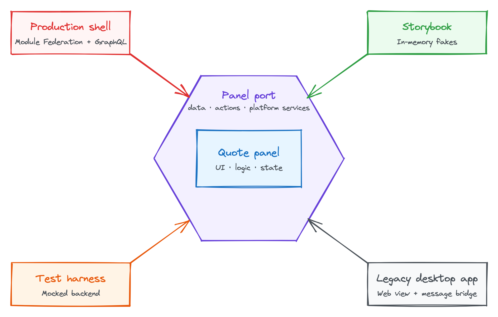

**TODO: summary for skimmers.** Three or four sentences a senior reader can
take away without reading on: a panel is defined by what it needs, not where it
runs. The panel depends only on a port; adapters fulfil the port for each host.
Mention the series and the companion repository.

## The problem with panels that know where they live

**TODO:** Introduce the invented trading workstation: a shell hosting dockable
panels, and the quote panel (live prices, submit an order). Show what goes
wrong when a panel imports the shell's notification service, reads settings
from a global, and calls GraphQL directly:

- It can't be developed without running the whole shell and backend.
- It can't be tested without a deployed environment.
- It can't be reused in another host, such as an older desktop app.

A short "before" code sample of a tightly coupled panel would set up the
contrast for the rest of the series.

## Hexagonal architecture in front-end terms

**TODO:** Explain ports and adapters from first principles for readers who
haven't met it. Link to Alistair Cockburn's original article. Translate the
server-side framing:

- The **application core** is the panel: its UI, logic and state.
- A **port** is the interface describing everything the panel needs from
  outside.
- An **adapter** fulfils the port for one host.
- Dependencies point inwards: adapters know about the panel, the panel never
  knows about adapters.

Keep it concrete. Avoid the abstract hexagon talk until the diagram.

<copy-to-clipboard data-url="/img/blog/ports-and-adapters-for-micro-frontends/panel-hexagon.png" class="ctc-image">
  <figure>
    
    <figcaption>
      The quote panel depends only on its port; each host supplies an adapter
    </figcaption>
  </figure>
</copy-to-clipboard>

## Defining the panel port

**TODO:** The heart of the post. Walk through the quote panel's port in
TypeScript, built up in two halves.

### Panel domain: data and actions

**TODO:** The panel's own business capabilities live on the port, not just
shell services:

- **Data:** quotes for a set of instruments, with live updates.
- **Actions:** `submitOrder`, and an editing action such as amending an order.

The panel calls these without knowing how they're carried out. Code sample:
the domain part of the port interface.

### Platform services

**TODO:** What the host provides to every panel:

- Notifications.
- User settings.
- The event bus for inter-panel messages, such as another panel selecting an
  instrument.
- Theming, including the data grid theme.

Code sample: the platform services part of the port interface.

## Why the API client belongs in the adapter

**TODO:** The panel never creates or imports a GraphQL client. The production
adapter owns the Apollo client and uses it to fulfil the port's data and
actions, so the host controls endpoints, authentication and caching. Other
adapters don't need GraphQL at all. Make the point that GraphQL is one way of
fulfilling the port, not a dependency of the panel.

## One panel, four hosts

**TODO:** Preview the payoff without the detail (that's part 3). A short table
or list of the four adapters and what each one provides:

- **Production shell:** loaded with Module Federation, data and actions over
  GraphQL.
- **Storybook:** in-memory fakes; no GraphQL, shell or network.
- **Test harness:** a mocked backend for end-to-end tests.
- **Legacy desktop app:** a web view, with actions routed through the desktop
  app's own services.

## What's next

**TODO:** Point to part 2, building the base panel that turns the port into
hooks and a store. Link to the companion repository.
