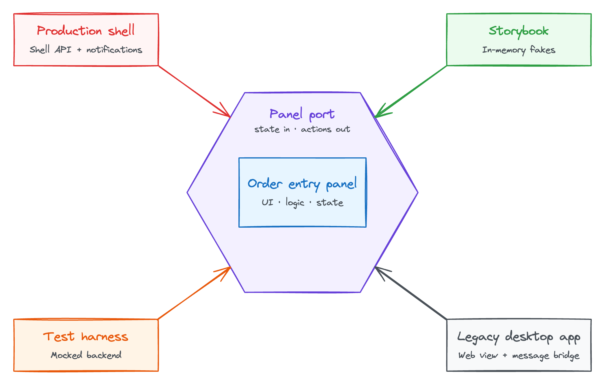

Micro-frontend architecture for enterprise level web applications is an
effective approach when many teams are building features over a centralised
platform, but it takes planning and discipline in the execution to get right. In
this series of posts I will cover how to apply hexagonal architecture (ports and
adapters) to these micro-frontends so that they can be developed and tested in
isolation.

## The problem with micro-frontends that know where they live

I will use a trading platform as an illustration of the concepts covered in
these posts but the ideas are portable to any large web app. Within the app the
micro-frontends will need to interact with each other and the core app or shell.
The shell loads the micro-frontends and makes available a set of capabilities
such as sending messages to other frontends and managing global state like
account settings.

These shared capabilities come in the form of singleton modules loaded by the
shell and made available to the micro-frontends as separate packages. Teams run
a development version of the shell on their machine and build their panels using
the shared capabilities.



```tsx
// Shared third-party singleton: the shell owns the version and the query client
import { useMutation } from "@tanstack/react-query";

// Shared first-party singleton: the shell configures the endpoint and auth
import { api } from "@shell/api";

// Shared first-party singleton: only works when the shell has loaded it and
// rendered its notification UI
import { useNotifications } from "@shell/notifications";

type Bid = { instrumentId: string; price: number; quantity: number };

export function OrderEntry({ instrumentId }: { instrumentId: string }) {
  // Throws without the shell's notification provider above it
  const { notify } = useNotifications();

  // Throws without the shell's QueryClientProvider above it
  const submitBid = useMutation({
    // The panel knows the platform's API route and payload
    mutationFn: (bid: Bid) => api.post("/orders/bids", bid),
    onSuccess: (_data, { price }) =>
      notify({ type: "success", message: `Bid submitted at ${price}` }),
    onError: () =>
      notify({ type: "error", message: "Bid could not be submitted" }),
  });

  return (
    <form
      onSubmit={(event) => {
        event.preventDefault();
        const form = new FormData(event.currentTarget);
        submitBid.mutate({
          instrumentId,
          price: Number(form.get("price")),
          quantity: Number(form.get("quantity")),
        });
      }}>
      <label>
        Bid price
        <input name="price" type="number" min="0" step="any" required />
      </label>
      <label>
        Quantity
        <input name="quantity" type="number" min="1" required />
      </label>
      <button disabled={submitBid.isPending}>Submit bid</button>
    </form>
  );
}
```



This is a common approach and it can be done well with the right abstractions
and use of testing utilities like MSW but over time the coupling to the platform
across the micro-frontend will inevitably make it difficult to maintain with
changes to both first and third party dependencies present in multipel locations
across the codebase.

With an interface defined at the edges of the micro-frontends that abstracts
state changes coming in and actions going out we can build, test, and deploy
them independently.

## Hexagonal architecture in front-end terms

**TODO:** Explain ports and adapters from first principles for readers who
haven't met it. Link to Alistair Cockburn's original article. Translate the
server-side framing:

- The **application core** is the panel: its UI, logic and state.
- A **port** is the interface describing everything the panel needs from
  outside.
- An **adapter** fulfils the port for one host.
- Dependencies point inwards: adapters know about the panel, the panel never
  knows about adapters.

Keep it concrete. Avoid the abstract hexagon talk until the diagram.

<copy-to-clipboard data-url="/img/blog/ports-and-adapters-for-micro-frontends/panel-hexagon.png" class="ctc-image">
  <figure>
    
    <figcaption>
      The quote panel depends only on its port; each host supplies an adapter
    </figcaption>
  </figure>
</copy-to-clipboard>

## Defining the panel port

**TODO:** The heart of the post. Walk through the quote panel's port in
TypeScript, built up in two halves.

### Panel domain: data and actions

**TODO:** The panel's own business capabilities live on the port, not just shell
services:

- **Data:** quotes for a set of instruments, with live updates.
- **Actions:** `submitOrder`, and an editing action such as amending an order.

The panel calls these without knowing how they're carried out. Code sample: the
domain part of the port interface.

### Platform services

**TODO:** What the host provides to every panel:

- Notifications.
- User settings.
- The event bus for inter-panel messages, such as another panel selecting an
  instrument.
- Theming, including the data grid theme.

Code sample: the platform services part of the port interface.

## Why the API client belongs in the adapter

**TODO:** The panel never creates or imports a GraphQL client. The production
adapter owns the Apollo client and uses it to fulfil the port's data and
actions, so the host controls endpoints, authentication and caching. Other
adapters don't need GraphQL at all. Make the point that GraphQL is one way of
fulfilling the port, not a dependency of the panel.

## One panel, four hosts

**TODO:** Preview the payoff without the detail (that's part 3). A short table
or list of the four adapters and what each one provides:

- **Production shell:** loaded with Module Federation, data and actions over
  GraphQL.
- **Storybook:** in-memory fakes; no GraphQL, shell or network.
- **Test harness:** a mocked backend for end-to-end tests.
- **Legacy desktop app:** a web view, with actions routed through the desktop
  app's own services.

## What's next

**TODO:** Point to part 2, building the base panel that turns the port into
hooks and a store. Link to the companion repository.
