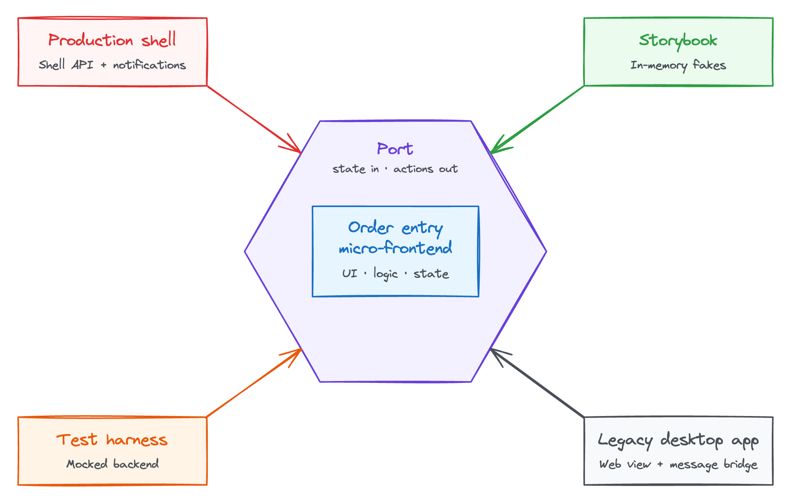

Micro-frontend architecture for enterprise-level web applications is an
effective approach when many teams are building features over a centralised
platform, but it takes planning and discipline in the execution to get right. In
this series of posts I'll cover how to apply hexagonal architecture (ports and
adapters) to these micro-frontends so that they can be developed and tested in
isolation.

The core idea is that a micro-frontend is defined by what it needs, not where it
runs. This post covers the pattern, part 2 builds a base micro-frontend with it
and part 3 runs the same micro-frontend in different hosts.

## The problem with micro-frontends that know where they live

I'll use a trading platform as an illustration of the concepts covered in these
posts, but the ideas are portable to any large web app. Within the app the
micro-frontends will need to interact with each other and the core app or shell.
The shell loads the micro-frontends and makes available a set of capabilities
such as sending messages to other micro-frontends and managing global state like
account settings.

These shared capabilities come in the form of packages that the shell shares
with the micro-frontends as singletons at runtime. Teams run a development
version of the shell on their machine and build their micro-frontends using the
shared capabilities.



```tsx
// Shared third-party singleton: the shell owns the version and the query client
import { useMutation } from "@tanstack/react-query";

// Shared first-party singleton: the shell configures the endpoint and auth
import { api } from "@shell/api";

// Shared first-party singleton: only works when the shell has loaded it and
// rendered its notification UI
import { useNotifications } from "@shell/notifications";

type Bid = { instrumentId: string; price: number; quantity: number };

export function OrderEntry({ instrumentId }: { instrumentId: string }) {
  // Throws without the shell's notification provider above it
  const { notify } = useNotifications();

  // Throws without the shell's QueryClientProvider above it
  const submitBid = useMutation({
    // The micro-frontend knows the platform's API route and payload
    mutationFn: (bid: Bid) => api.post("/orders/bids", bid),
    onSuccess: (_data, { price }) =>
      notify({ type: "success", message: `Bid submitted at ${price}` }),
    onError: () =>
      notify({ type: "error", message: "Bid could not be submitted" }),
  });

  return (
    <form
      onSubmit={(event) => {
        event.preventDefault();
        const form = new FormData(event.currentTarget);
        submitBid.mutate({
          instrumentId,
          price: Number(form.get("price")),
          quantity: Number(form.get("quantity")),
        });
      }}>
      <label>
        Bid price
        <input name="price" type="number" min="0" step="any" required />
      </label>
      <label>
        Quantity
        <input name="quantity" type="number" min="1" required />
      </label>
      <button disabled={submitBid.isPending}>Submit bid</button>
    </form>
  );
}
```



This is a common approach and it can be done well with the right abstractions
and use of testing utilities like
[Mock Service Worker (MSW)](https://mswjs.io/). Over time, the coupling to the
platform across the micro-frontend tends to make it difficult to maintain, with
changes to both first-party and third-party dependencies needed in multiple
locations across the codebase.

To run this form you need the shell, its providers and a backend. To test it you
need to mock all three. To host it anywhere else you need to recreate them or
rewrite the form.

With an interface defined at the edges of the micro-frontends that abstracts
state changes coming in and actions going out, they can be developed and tested
without the shell, and run in more than one host.

## Hexagonal architecture in front-end terms

Alistair Cockburn described
[hexagonal architecture](https://alistair.cockburn.us/hexagonal-architecture),
or ports and adapters, in 2005 as a way for an application "to be developed and
tested in isolation from its eventual run-time devices and databases". Replace
devices and databases with the shell and its shared modules and the same goal
applies to a micro-frontend. The pattern has three parts:

- **The application** is the micro-frontend's logic and state: the bid it builds
  from the user's input, the instrument it's for and whether it's being
  submitted. The order entry form drives it and ships with it.
- **A port** is an interface that describes what the micro-frontend needs from
  the outside, in its own terms. Order entry needs to know which instrument the
  bid is for and to submit the bid.
- **An adapter** implements the port for one host. In the production shell,
  submitting a bid calls the shell's API and notifies the user of the outcome.
  In Storybook it can show the form mid-submission without making a request.

In Cockburn's article the UI sits outside the application and drives it through
a port, which means tests can take its place. The same applies to a
micro-frontend built this way: its UI only reads state and calls actions, and
never reaches past the port. The UI is also part of what a micro-frontend ships,
so it needs testing too. In Storybook and the test harness the real UI stays in
place and the adapter behind the port changes.

The important change is the direction of the dependencies. `OrderEntry` imports
`@shell/api` and `@shell/notifications`, so the micro-frontend depends on the
shell. With a port the dependency is inverted. The micro-frontend defines the
interface, each adapter depends on that interface to implement it and the host
chooses which adapter to provide when it mounts the micro-frontend. The
micro-frontend never imports an adapter, so it doesn't know which host it's
running in.

The port covers traffic in both directions. State changes come in, such as the
user selecting a different instrument in another micro-frontend, and actions go
out, such as submitting a bid. The number of sides on the hexagon has no
meaning, it just leaves room to draw an adapter for each host.

<copy-to-clipboard data-url="/img/blog/ports-and-adapters-for-micro-frontends/micro-frontend-hexagon.png" class="ctc-image">
  <figure>
    
    <figcaption>
      The order entry micro-frontend depends only on its port; each host supplies an
      adapter
    </figcaption>
  </figure>
</copy-to-clipboard>

## Defining the port

Notifying the user and calling the API are both consequences of submitting a
bid, and neither needs the form. If they move out to the adapter then order
entry only needs two things from the outside: the state to render and the
actions the user can take.

```ts
// order-entry/port.ts
export type Bid = { instrumentId: string; price: number; quantity: number };

export type OrderEntryState = {
  // Changes when the user selects an instrument in another micro-frontend
  instrumentId: string;
  isSubmitting: boolean;
};

export type OrderEntryActions = {
  submitBid: (bid: Bid) => void;
};

export interface OrderEntryPort {
  // The micro-frontend can read the store but not write to it
  store: {
    getState: () => OrderEntryState;
    subscribe: (listener: () => void) => () => void;
  };
  actions: OrderEntryActions;
}
```

There's no mention of an API, a notification or a message from another
micro-frontend. Those are details of the host, and by the time they reach the
port they've become state or actions described in terms of order entry.

The micro-frontend isn't just the UI. It owns the shape of its state, the
actions and the hooks that connect them to the form. The values live outside in
an external store that the adapter supplies. The adapter writes to the store,
whether that's because a request started or a message arrived from elsewhere in
the app, and the micro-frontend subscribes to the changes.

`submitBid` doesn't return anything. The outcome belongs to the adapter, and
whatever the form needs to know about it comes back through the state. If the
form needed to show an inline error, for example, that would be another property
on `OrderEntryState`.

### Hooks for state and actions

The port is plain TypeScript with no dependency on React. To use it from
components, React context provides the port and a hook covers each value the
component reads and each action it can take, along with that action's progress.

```ts
// order-entry/hooks.ts
import { createContext, useContext, useSyncExternalStore } from "react";
import type { OrderEntryPort, OrderEntryState } from "./port";

const OrderEntryContext = createContext<OrderEntryPort | null>(null);

// Each host wraps the micro-frontend in this to provide its adapter
export const OrderEntryProvider = OrderEntryContext.Provider;

function useOrderEntryPort() {
  const port = useContext(OrderEntryContext);
  if (!port) {
    throw new Error("OrderEntry must be rendered inside OrderEntryProvider");
  }
  return port;
}

function useSelector<T>(selector: (state: OrderEntryState) => T): T {
  const { store } = useOrderEntryPort();
  return useSyncExternalStore(store.subscribe, () =>
    selector(store.getState()),
  );
}

// State in
export const useInstrumentId = () => useSelector((state) => state.instrumentId);

// Action out, with its progress coming back in
export function useSubmitBid() {
  const { submitBid } = useOrderEntryPort().actions;
  const isSubmitting = useSelector((state) => state.isSubmitting);

  return { submitBid, isSubmitting };
}
```

`useSubmitBid` returns the action and its progress together, in a similar shape
to `useMutation`. `useOrderEntryPort` and `useSelector` aren't exported, so
components never see the shape of the state or the port. If either one changes
then the hooks change with it and the components stay the same.

The context value is the port rather than the state, so it doesn't change when
the state does. Each hook selects a single value and the component only
re-renders when that value changes, which I covered in
[Isolating React component updates with useSyncExternalStore](/blog/isolating-react-component-updates-with-usesyncexternalstore/).

With the hooks in place, `OrderEntry` no longer imports anything from the shell.



```tsx
// order-entry/order-entry.tsx
import { useInstrumentId, useSubmitBid } from "./hooks";

export function OrderEntry() {
  const instrumentId = useInstrumentId();
  const { submitBid, isSubmitting } = useSubmitBid();

  return (
    <form
      onSubmit={(event) => {
        event.preventDefault();
        const form = new FormData(event.currentTarget);
        submitBid({
          instrumentId,
          price: Number(form.get("price")),
          quantity: Number(form.get("quantity")),
        });
      }}>
      <label>
        Bid price
        <input name="price" type="number" min="0" step="any" required />
      </label>
      <label>
        Quantity
        <input name="quantity" type="number" min="1" required />
      </label>
      <button disabled={isSubmitting}>Submit bid</button>
    </form>
  );
}
```



### An adapter for the shell

The code that was removed from `OrderEntry` hasn't gone away, it's moved to the
adapter for the production shell. This is the only place that knows about React
Query, the shell's packages and the API route.

First it needs a store. A small function covers the `getState` and `subscribe`
functions the port asks for, along with a `setState` function for the adapter
that the port's type doesn't expose.

```ts
// shell-adapter/create-store.ts
export function createStore<T extends object>(initialState: T) {
  let state = initialState;
  const listeners = new Set<() => void>();

  return {
    getState: () => state,
    subscribe: (listener: () => void) => {
      listeners.add(listener);
      return () => {
        listeners.delete(listener);
      };
    },
    setState: (changes: Partial<T>) => {
      state = { ...state, ...changes };
      for (const listener of listeners) listener();
    },
  };
}
```

The adapter creates the store, keeps it up to date and provides it to the
micro-frontend as part of the port.



```tsx
// shell-adapter/shell-adapter.tsx
import { useEffect, useMemo, useState, type ReactNode } from "react";
import { useMutation } from "@tanstack/react-query";
import { api } from "@shell/api";
import { messages } from "@shell/messages";
import { useNotifications } from "@shell/notifications";
import { OrderEntryProvider } from "../order-entry/hooks";
import type { Bid, OrderEntryPort, OrderEntryState } from "../order-entry/port";
import { createStore } from "./create-store";

type Props = { instrumentId: string; children: ReactNode };

export function ShellAdapter({ instrumentId, children }: Props) {
  const { notify } = useNotifications();

  // The external store, created once for each mounted micro-frontend
  const [store] = useState(() =>
    createStore<OrderEntryState>({ instrumentId, isSubmitting: false }),
  );

  // State in: messages from other micro-frontends update the store
  useEffect(
    () =>
      messages.subscribe("instrument-selected", (message) =>
        store.setState({ instrumentId: message.instrumentId }),
      ),
    [store],
  );

  // Actions out: submitting a bid calls the API and notifies the user
  const { mutate: submitBid } = useMutation({
    mutationFn: (bid: Bid) => api.post("/orders/bids", bid),
    onMutate: () => store.setState({ isSubmitting: true }),
    onSuccess: (_data, { price }) =>
      notify({ type: "success", message: `Bid submitted at ${price}` }),
    onError: () =>
      notify({ type: "error", message: "Bid could not be submitted" }),
    onSettled: () => store.setState({ isSubmitting: false }),
  });

  const port = useMemo<OrderEntryPort>(
    () => ({ store, actions: { submitBid } }),
    [store, submitBid],
  );

  return <OrderEntryProvider value={port}>{children}</OrderEntryProvider>;
}
```



The shell renders `OrderEntry` inside the adapter and the micro-frontend runs as
it did before.

## Why the API client belongs in the adapter

**TODO:** The micro-frontend never creates or imports a GraphQL client. The
production adapter owns the Apollo client and uses it to fulfil the port's data
and actions, so the host controls endpoints, authentication and caching. Other
adapters don't need GraphQL at all. Make the point that GraphQL is one way of
fulfilling the port, not a dependency of the micro-frontend.

## One micro-frontend, four hosts

**TODO:** Preview the payoff without the detail (that's part 3). A short table
or list of the four adapters and what each one provides:

- **Production shell:** loaded with Module Federation, data and actions over
  GraphQL.
- **Storybook:** in-memory fakes; no GraphQL, shell or network.
- **Test harness:** a mocked backend for end-to-end tests.
- **Legacy desktop app:** a web view, with actions routed through the desktop
  app's own services.

## What's next

**TODO:** Point to part 2, building the base micro-frontend that turns the port
into hooks and a store. Link to the companion repository.
